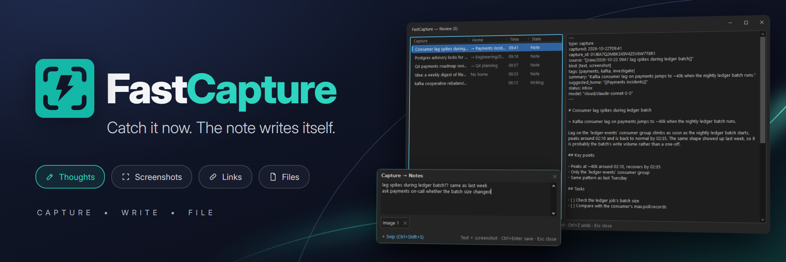
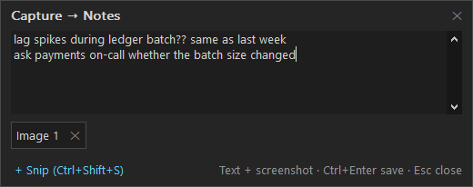
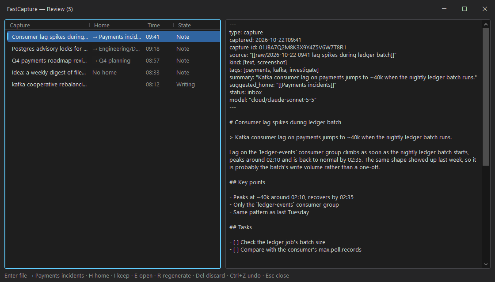
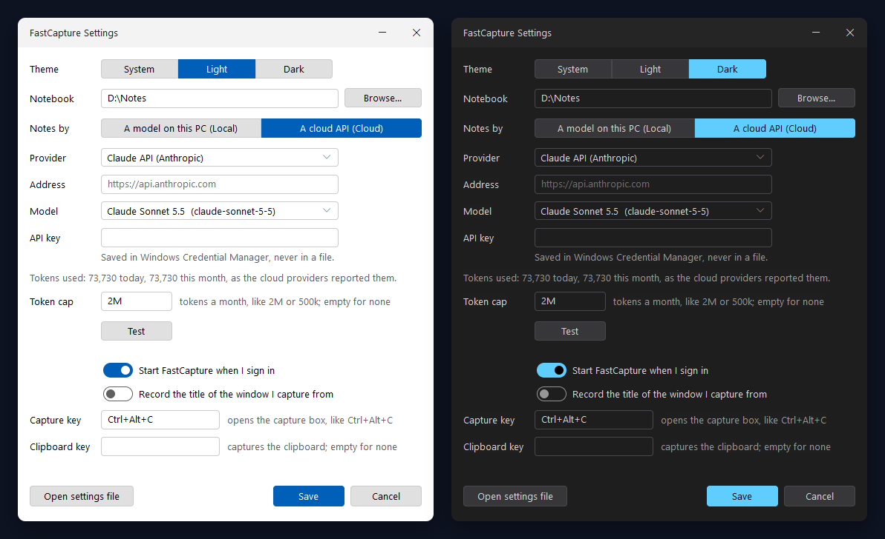

<div align="center">


# FastCapture

**Catch it now. The note writes itself.**

One key from anywhere, and the thought, screenshot, web page or file you came across is saved.
An AI model, on your PC or in the cloud, turns it into a well-written Markdown note in your notebook.

[](https://github.com/coccor/FastCapture/releases/latest)
[](LICENSE)

[](https://github.com/coccor/FastCapture/releases)

[**Download**](https://github.com/coccor/FastCapture/releases/latest) · [Install](#install-in-a-minute) · [Features](#capture-it-before-its-gone) · [Models](#local-or-cloud) · [Privacy](#privacy)



</div>

## Why FastCapture

Notes you mean to write later rarely get written. FastCapture splits the job: you only catch the
thing, in a second, without leaving what you're doing; reading it, writing it up and finding where
it belongs happen in the background.

- **One key, from anywhere.** **Ctrl+Alt+C** opens a small box over whatever you're doing. Type,
  paste, snip or drop files, then **Ctrl+Enter** and you're back.
- **The original is never lost.** Every capture is saved as written, with its attachments, before
  any model sees it. Pages it links to and documents attached to it are read on your PC.
- **Notes that link and file themselves.** The model writes a title, summary, key points and
  tasks, links the notes it relates to, and suggests a home. One key files it there.
- **Your model, your choice.** A model on this PC (Ollama, LM Studio, Foundry Local), the Claude
  API, any OpenAI-compatible API, or your own Claude Code or GitHub Copilot plan. In Local mode
  nothing you capture leaves your PC.
- **Plain Markdown.** Files with YAML front matter in a folder you choose.
  [FastPad](https://github.com/coccor/FastPad), Obsidian, any other editor or an AI agent reads
  them. No database, no account, no lock-in.

Written in Rust directly on Win32. It sits in the notification area and starts when you sign in.

## Install in a minute

1. Download `FastCapture-<version>-windows-x64.zip` (or `-arm64.zip`) from the
   [latest release](https://github.com/coccor/FastCapture/releases/latest). Each zip has a
   `.sha256` file beside it so you can verify what you downloaded.
2. Unzip it anywhere and run `fastcapture.exe`. It appears in the notification area.
3. Right-click the tray icon › **Settings…** and choose how notes are written (see
   [Local or Cloud](#local-or-cloud)). Until you choose, captures wait in the queue; nothing is lost.
4. Press **Ctrl+Alt+C**.

Requires Windows 10 1809 or later, or Windows 11.

> **"Windows protected your PC"?** Releases aren't code-signed yet, so SmartScreen may warn on
> first run. Choose **More info > Run anyway**, or check the zip against its `.sha256` first.

## Capture it before it's gone



| Key or action | What it does |
|---|---|
| **Ctrl+Alt+C** (anywhere) | Opens the capture box. Settings › **Capture key** changes it. |
| Tray icon, click | Opens the review window |
| Tray icon, right click | Capture…, Capture clipboard, Review, Pause processing, Settings…, Open settings file, Open notebook folder, Quit |
| Settings › **Clipboard key** (none by default) | Captures the clipboard as it is, with no box |

### The capture box

Type what the capture is about, then add what you want to keep with it:

| Key | |
|---|---|
| **Ctrl+V** | Pastes text, or attaches an image (when the clipboard holds no text) or files copied in Explorer. Text copied from a browser or Word with headings, lists, links, tables or code is pasted as Markdown. |
| **Ctrl+Alt+V** | Pastes the plain text, even when the clipboard holds formatted text |
| **Ctrl+Shift+V** | Attaches the clipboard's image even when it also holds text |
| **Ctrl+Shift+S** or **+ Snip** | Hides the box and starts Windows' snipping tool; the snip is attached when the box comes back |
| Drop files on the box | Attaches them (copied, never moved; files over 20 MB ask first) |
| **Ctrl+N** or the notebook's name in the title | Sends this capture to a recent notebook, or to any folder with **Other folder…** |
| **Tab** | Moves to the attachments: arrows to choose, **Delete** to remove |
| **Ctrl+Enter** | Saves and closes |
| **Esc** | Closes, keeping what you wrote as a draft for next time |

A line holding only an `http(s)://` address is recorded as a link. The footer shows what the capture holds ("Text + screenshot"). When pasted text came from a web page, the browser's note of that page is kept with it (`source_url`). The clipboard hotkey pastes the same way.

The title says where the capture goes ("Capture → Notes"). The notebook chosen there is for this capture only; Settings' notebook stays as it is. A folder picked with **Other folder…** joins the recent notebooks once a capture is filed there.

Drag the box's edges or corners to resize it; it opens at the size you last left it. As you type, common English typos are fixed when you finish the word ("teh " becomes "the "); **Ctrl+Z** right after a fix puts back what you typed. Only words Windows' spell checker is sure of are changed, and never pasted text, web addresses, paths or #tags. Settings › **Fix common typos as I type (English)** turns it off.

### From scripts and agents: `fastcapture add`

The same with no window:

```
fastcapture add "lag spikes during ledger batch??" --attach C:\logs\ledger.log
fastcapture add --url https://example.com/article "why this matters"
echo "from a pipe" | fastcapture add -
fastcapture add "elsewhere" --notebook D:\Work
```

It prints the raw source's path. Exit codes: 0 saved, 1 saving failed, 2 bad arguments, text over 1 MB, a missing file or a file over 20 MB. When the tray app is running, the capture goes through it; otherwise `add` saves it and the tray app finds it on its next start.

## A note, written for you

Before a note is written, FastCapture reads what you captured, on this PC, with no model:

| Captured | What the model gets |
|---|---|
| Your text | All of it |
| A link | The page's main content as Markdown (navigation, ads, comments and footers left out), with its title, site and date. Fetched once, as a browser would but without cookies, within 10 s and 5 MB; at most 3 links per capture. |
| A PDF | The text of each page. A page with almost no text (a scan) is rendered and sent as an image. |
| A Word `.docx` | Its text, with headings, lists and tables |
| Text, logs, code | Their text, in any common encoding. A log over 400 lines keeps its first and last 200. |
| Screenshots and images | The images, scaled to at most 1,568 pixels on the long side |
| Other files | Their name, type and size |

Limits, so one capture can't cost much: 60,000 characters of material (your text doesn't count), 20 PDF pages and 8 images. Whatever is cut is named in the note's `truncated:` front matter. A page that can't be fetched (a 403, a site that needs JavaScript or a login) is noted, and the note is written from your text; a page that can't be reached yet (offline) is tried again later, three times at most.

The model writes the note: a title, a one-line summary, the body, key points, tasks, the notes it relates to and the links you captured, with your attachments at the end.

### Links and homes

FastCapture keeps a keyword index of the notebook (on this PC, kept current as notes change). For each capture it looks up the notes your text, the pages' titles and the start of the material share the most words with, and offers the 30 best to the model as candidates. The model links the ones the capture really relates to under `## Related`, in the form FastPad's link completion uses, and may link a clearly new subject as a new note. Links to notes that weren't offered are dropped.

The model also suggests a **home**, kept in `suggested_home:`: a **home note** among the candidates, one whose `type:` is in `capture.ini`'s `home_types` (`topic`, `project` and `moc` by default), or a **folder** holding candidates. Search matches words, not meaning: a note that says the same thing in other words won't be found.

## Review and file in a keystroke



The review window lists the notes waiting in your inbox, newest first, each with the home the model suggested (`→ Payments incidents`), and the captures still queued, being written or failed. A capture that failed shows why. The note, or the raw source, is shown beside the list. Notes you file, keep or discard leave the list.

| Key | |
|---|---|
| **Enter** | Files the note in its suggested home (see [Filing](#filing)); with no suggestion, opens the folder |
| **H** | Picks another home: folders and home notes, filtered as you type, the suggestion first. **Enter** files there, **Esc** closes. |
| **I** | Keeps the note in the inbox (`status: kept`) and takes it off the list |
| **Ctrl+Z** | Undoes the last file, keep or discard in this window, unless the files changed since |
| **E** or double-click | Opens the note, or the raw source when there is no note, in FastPad when it is installed, else in your default `.md` editor |
| **R** | Writes the note again with the current settings. If you edited the note since, it asks first. For a finding an agent wrote, finds its home and links again, without asking: its text isn't replaced. |
| **Del** | Sends the note to the Recycle Bin and keeps the capture; with no note, the capture goes too |
| **Shift+Del** | Sends the note, the capture and the attachments only it links to, to the Recycle Bin |
| **F5** | Refreshes |
| **Esc** | Closes |

The footer shows the keys that apply to the selected row. The tray icon's tooltip counts the notes waiting in the inbox.

### Filing

- **Into a folder:** the note moves there, under a free name (` 2`, ` 3`… when the name is taken). Its links to its attachments are rewritten so they keep working.
- **Under a home note:** the note moves into the home note's folder, and a line is added at the end of the home note, in its list when it ends with one:

  ```markdown
  - 2026-10-19 [[Consumer lag spikes during ledger batch]]: Kafka consumer lag on payments jumps to ~40k…
  ```

- Either way, `status:` becomes `filed` and `suggested_home:` goes; nothing else in the note's front matter changes. A home note that can't be written (it's locked, or gone) leaves the note in the inbox with the reason. Files are written atomically and read again if they change meanwhile, so an open FastPad tab takes the change as an outside edit.

## Findings from coding agents

Coding agents (Claude Code, opencode, Copilot, …) can keep what they learn in your notebook: a root cause, a decision and why, a trap, a procedure that worked, an approach that failed. The skill in [`skills/fastcapture-notes`](skills/fastcapture-notes/SKILL.md) tells them when a finding is worth a note, how to write it (`type: finding`, `status: inbox`, in the capture folder) and how to find the project's notebook; copy that folder into `%USERPROFILE%\.claude\skills\`, or your agent's skills folder. It works without FastCapture.

When FastCapture runs, it looks in the capture folders of the notebooks it knows (`notebook` and `recent_notebook` in the settings) for findings, once they have stopped changing for 2 seconds. It doesn't write the finding again: it asks the model only for the notes it relates to and its home, among the same candidates a capture gets, and adds them, `suggested_home:` in the front matter and links missing under `## Related`; the agent's words stay as they are. The finding is then listed in the review window, with the agent's name in the State column, and filed, kept or discarded like any note. A finding whose front matter can't be read is listed as failed, with why; fix it and press **R**.

## Themes that match FastPad



FastCapture looks like [FastPad](https://github.com/coccor/FastPad), its sibling: the same light and dark colors, Segoe UI Variable on Windows 11, rounded fields and buttons, and one blue focus ring for the keyboard. **Theme** at the top of Settings is **System** (light or dark as Windows' apps are, and following Windows when it changes), **Light** or **Dark**. A choice shows at once in every open window; Cancel puts the saved one back. In high contrast FastCapture uses Windows' own colors, whatever the theme.

Every window, the tray menu and FastCapture's questions are drawn in the theme. They stay keyboard-first and readable by screen readers: the controls are Windows' own, painted, and the menus are lists of named items.

## Local or Cloud

Tray menu › **Settings…** chooses how notes are written and the everyday options. **Open settings file** opens `fastcapture.ini` for the rest; changes apply when you save it.

Notes are written by one model, never both:

- **A model on this PC (Local):** an OpenAI-compatible server running here, such as Ollama, LM Studio or Foundry Local. **Find servers** looks for them; choose a model it lists. Only addresses on this PC are accepted, so nothing leaves it. If the model doesn't read images, screenshots are attached to notes unread.
- **A cloud API (Cloud)**, from one of four providers:
  - **Claude API:** from [console.anthropic.com](https://console.anthropic.com) › API Keys; choose Sonnet, Opus or Haiku.
  - **OpenAI-compatible API:** any service that answers OpenAI's chat completions: give its base address, a model and your key. **List models** asks the service for its models; you can also type one. For example, `https://api.openai.com/v1` (OpenAI), `https://openrouter.ai/api/v1` (OpenRouter, with models such as `openai/gpt-5-mini`), or `https://<resource>.openai.azure.com/openai/v1` (Azure OpenAI, whose model is your deployment's name). The address must be `https://`. A service without structured output gets the note's schema in the prompt instead; a model that can't read images fails captures with screenshots and says so.

  - **Claude Code (your Claude plan, experimental):** for a Claude Pro or Max plan instead of an API key. FastCapture runs your own installed Claude Code once per note, with no tools, signed in with your plan; see [Claude Code](#claude-code) below.
  - **GitHub Copilot (your Copilot plan, experimental):** for a GitHub Copilot plan, Free included, instead of an API key. FastCapture runs your own installed Copilot CLI once per note, with no tools, signed in with your GitHub account; see [GitHub Copilot](#github-copilot) below.

  The two APIs take your own key, saved in Windows Credential Manager (`FastCapture/claude`, `FastCapture/openai`), never in a file or the log. Choosing Cloud asks you to confirm what will be sent, and to whom: once for Anthropic, once for Claude Code, once for GitHub Copilot, and again whenever the OpenAI-compatible address moves to another host.

**Test** writes a note from a sample capture with what you chose. Until you choose, captures wait in the queue; nothing is lost. **Pause processing** in the tray menu holds them too. A rejected key or a billing problem pauses processing with a notification; a network error or an overloaded API is retried after 30 seconds, 2 minutes, 10 minutes, then every 30 minutes.

### What is sent

For each capture: the writing rules, what you typed, what was read from its links and files (see [A note, written for you](#a-note-written-for-you)), today's date, the notebook's name, the page pasted text came from and, when `capture_source` is on, the window title. Screenshots, images and scanned PDF pages go too, up to 8 per capture. So do the candidate notes: for each of up to 30, its name, folder, aliases, tags, type and the first 300 characters of its text; the folders they are in; and the notebook's 50 most used tags. Nothing else from your notebook is sent. In Local mode all of this stays on this PC.

### What Cloud costs

You pay the provider per token. With the Claude API you pay Anthropic. A capture is the rules (about 1,500 tokens, read from the cache after the first capture at a tenth of the price), a few hundred tokens of your text, and about 1,600 more for a full-screen screenshot. The note itself is 200–400 tokens. Roughly, per capture:

| Model | Text only | With a screenshot |
|---|---|---|
| Claude Sonnet 5.5 (default) | about 0.4 US cents | about 0.8 cents |
| Claude Opus 5.5 | about 0.8 cents | about 1.5 cents |
| Claude Haiku 5.5 | under 0.05 cents | under 0.1 cents |

A link or a document adds its text: about one token per four characters, so a typical article (6,000 characters) adds about 1,500 tokens and the 60,000-character limit about 15,000. Candidate notes add about 100 tokens each, so 30 of them about 3,000.

Measured on Haiku 5.5, besides the cached rules: a short text capture used 103 input and 225 output tokens; the same with a 1200×600 chart, 1,037 and 345; a Wikipedia article, 2,475 and 504; a 2-page PDF guide, 1,504 and 648; a short capture with 7 candidate notes, 900 and 391. Prices change; see Anthropic's pricing page.

An OpenAI-compatible model reads the same request, so it takes a similar number of tokens, give or take how its tokenizer counts; the price is the provider's. Whether the rules are read from a cache, and how cheaply, is up to the provider too.

### Claude Code

Install Claude Code for Windows (the native installer puts `claude.exe` in `%USERPROFILE%\.local\bin`, which FastCapture looks in even when it isn't on `PATH`), then sign in once in a terminal: run `claude`, type `/login`, and sign in with your Claude account. A Claude Code installed in WSL can't be used. Settings shows the version found and whether it is signed in, and **Test** writes a sample note through it. Choose `sonnet` (the default), `opus` or `haiku`, or type a model name Claude Code accepts; `claude_code_path` in the settings file points at another `claude.exe`.

For each capture FastCapture runs `claude -p` with no tools, no MCP servers, none of your Claude Code settings or hooks, and no saved session, in an empty folder of its own, so it can't read or change anything on this PC. The capture goes in as one message, with its images, and the note comes back as structured output. API keys and base addresses in the environment are removed, so your plan's login is used. Notes count against your plan's usage limits, not a token bill: they aren't in the tokens used or the cap. When the plan's limit is reached, processing pauses until it resets (the time Claude Code reports, else 30 minutes), then carries on by itself. Signed out, or a model your plan doesn't offer, pauses it with a notification.

A note takes 4–8 seconds, 2–4 more than the Claude API, mostly Claude Code starting. Measured on a Max plan with Claude Code 2.1.303, besides the cached rules: a short text capture used about 2,400 input and 370–570 output tokens; a chart screenshot about 1,700 and 540–1,170; a Wikipedia article about 3,100 and 900–1,100.

It is **experimental** and for your own use: Anthropic lets you use Claude Code with your own plan, but its terms don't say whether another app may start it for you, so this may have to change. FastCapture never reads, copies or stores your Claude login. Claude Code updates itself; a version from before `--json-schema` still works, with the schema in the rules, but one installed through npm that can't read its rules from a file is refused, with a notification asking for `claude update`.

### GitHub Copilot

Install the Copilot CLI (`winget install GitHub.Copilot`, or `npm install -g @github/copilot` with Node 22 or later), then sign in once in a terminal with `copilot login`. A `gh` login alone isn't enough: through it the CLI offers no models. Settings shows the version found, who is signed in, the chat requests your plan has left this month when it counts them, and fills **Model** with the models your plan offers: `auto` (the default, which lets Copilot choose) is the only one on Copilot Free. **Test** writes a sample note through it; `copilot_path` in the settings file points at another `copilot.exe`. An npm install's `copilot.cmd` is followed to the program inside its package, which is started directly.

For each capture FastCapture starts `copilot` as a server, as GitHub's Copilot SDKs do, in an empty folder of its own, and runs one session: no tools, none of your instructions, skills or MCP servers, its own prompt replaced by FastCapture's writing rules, the images as attachments and the note's schema as the reply's format. The session is deleted afterwards and nothing of it is saved. The capture goes to GitHub, which passes it on to the model's provider. Notes use your Copilot plan's allowance; the tokens each note used are counted in the tokens used and toward the cap, like the APIs'. A used-up allowance or an account-wide rate limit pauses processing for 30 minutes (Copilot doesn't say when it resets), then it carries on by itself; signed out, a model your plan doesn't offer, or an organization's policy pauses it with a notification.

A note takes 8–10 seconds, 2–3 more than through Claude Code. Measured on Copilot Free with CLI 1.0.100, where Auto chose GPT-6 Luna: a short text capture used about 900 input and 280 output tokens; a chart screenshot about 1,800 and 430; a Wikipedia article about 2,200 and 380.

It is **experimental** and for your own use: GitHub lets you use the Copilot CLI and SDK with your own plan, but its terms don't say whether another app may start the CLI for you, so this may have to change. FastCapture never reads, copies or stores your GitHub login, and starts the CLI with its updates turned off; update it yourself.

### Tokens used and the cap

Settings shows the tokens cloud notes used today and this month, added up from what each provider reported: input (cached included) and output, for the APIs and Copilot together. A capture asked twice (when the first reply wasn't a usable note) counts both requests. Local models are free and aren't counted, and neither is Claude Code, which has its plan's own limits.

**Token cap** (empty for none) is the most tokens cloud notes may use in a month, like `2M` or `500k`. Cached tokens count in full, so it stops early rather than late. Once the month reaches it, processing pauses with a notification and captures wait in the queue; raising the cap, or the next month, lets them run. A note already being written is finished, so a month can go over by one capture.

## Where things go

In the notebook (FastPad's conventions, read from `.fastpad\notebook.ini` and Obsidian's `.obsidian\app.json` when they exist; FastCapture never writes them):

- `inbox\<title>.md` (`notebook.ini`'s `capture_folder`): the note the model wrote, with the capture's facts in front matter (`captured`, `capture_id`, `source` linking the raw source, `kind`, `url` and `site` for a capture of one link, `tags`, `summary`, `suggested_home`, `truncated` when something was cut, `status: inbox`, `model`), then the title, summary, body, key points, tasks, related notes (`## Related`), the links captured (`## Source`) and attachments. FastPad's own quick captures may share this folder; FastCapture's notes are the ones with `type: capture`, and the findings coding agents write are `type: finding` (see [Findings from coding agents](#findings-from-coding-agents)). Filed notes move to their home.
- `raw\YYYY-MM-DD HHmm <first words>.md`: each capture's raw source, never changed after it is written. Its front matter holds `type: raw`, `captured`, `kind`, `capture_id`, any `urls`, `source_url` for pasted web text and, when enabled, `source_window`.
- `raw\<raw source's name>.page.md` (`.page 2.md`, …): each link's page as it was fetched, kept beside its raw source so the note can be written again without fetching it. A failed fetch is recorded there too, and replaced when **R** fetches it again.
- `attachments\`: pasted images (as PNG) and copied files, linked from the raw source.
- `.fastcapture\capture.ini` (optional): `raw_folder` (default `raw`), `home_types` (default `topic, project, moc`): the `type:` values that make a note a home, and `repos`: the repos the notebook covers, by root folder or remote (`C:/Projects/Payments, github.com/acme/payments`), so coding agents find it.

On this PC:

- `%AppData%\FastCapture\fastcapture.ini`: settings (below).
- `%LocalAppData%\FastCapture\queue\`: one file per capture waiting to be processed.
- `%LocalAppData%\FastCapture\draft\`: the capture box's draft.
- `%LocalAppData%\FastCapture\index\<folder key>.cache`: the notebook's index, so it doesn't read every note at each start. It can be deleted at any time.
- `%LocalAppData%\FastCapture\usage.txt`: the tokens cloud notes used, one line per day and model, as the APIs reported them. The last 13 months are kept.
- `%LocalAppData%\FastCapture\claude-code\`: the empty folder Claude Code runs in, with the writing rules it is given (`rules.md`).
- `%LocalAppData%\FastCapture\copilot\`: the empty folder the Copilot CLI runs in.
- `%LocalAppData%\FastCapture\log\fastcapture.log`: diagnostics. It never holds what you captured.

## Make it yours

Everything in Settings is saved to `%AppData%\FastCapture\fastcapture.ini`, one `key=value` per line. **Open settings file** in the tray menu opens it; changes apply when you save it.

| Key | Default | |
|---|---|---|
| `notebook` | FastPad's most recent notebook, else `Documents\FastPad` | The folder captures go to |
| `capture_hotkey` | `Ctrl+Alt+C` | Ctrl, Shift, Alt and Win with a letter, digit, F1–F24 or a named key (Space, Enter, Insert…). Empty turns it off. |
| `clipboard_hotkey` | (none) | Captures the clipboard with no box |
| `capture_source` | `false` | Records the title of the window in front when you capture. Off by default because titles can hold private things. |
| `autocorrect` | `true` | Fixes common English typos as you type in the capture box |
| `start_at_sign_in` | `true` | Starts FastCapture when you sign in |
| `theme` | `system` | `system`, `light` or `dark` |
| `recent_notebook` | | One line per notebook offered by the capture box's notebook menu |
| `capture_width`, `capture_height` | | The capture box's size, written when you resize it |
| `mode` | (none) | `local` or `cloud`, set by Settings |
| `local_endpoint`, `local_model` | | The local server's address and model |
| `backend` | `claude` | Cloud's provider: `claude`, `openai` (any OpenAI-compatible API), `claude_code` or `copilot` |
| `claude_model` | `claude-sonnet-5-5` | `claude-opus-5-5` and `claude-haiku-5-5` work too |
| `cloud_accepted` | `false` | Set when you confirm Cloud for Anthropic |
| `openai_endpoint`, `openai_model` | | The OpenAI-compatible API's `https://` base address and model |
| `openai_accepted` | | The host you confirmed Cloud for |
| `token_cap` | (none) | The most tokens cloud notes may use in a month (Claude Code's aside): a number, or with `k` or `M` |
| `claude_code_model` | `sonnet` | Claude Code's model: `sonnet`, `opus`, `haiku`, or a full name |
| `claude_code_path` | (found) | Where `claude.exe` is, when it isn't on `PATH` or in `%USERPROFILE%\.local\bin` |
| `claude_code_accepted` | `false` | Set when you confirm Cloud for Claude Code |
| `copilot_model` | `auto` | Copilot's model: `auto`, or one your plan offers |
| `copilot_path` | (found) | Where `copilot.exe` (or npm's `copilot.cmd`) is, when it isn't on `PATH` |
| `copilot_accepted` | `false` | Set when you confirm Cloud for GitHub Copilot |

**Capture key** and **Clipboard key** in Settings set the same two hotkeys, typed like `Ctrl+Shift+Space`, and take effect when you save. If a hotkey is already taken by another app, a notification says so; choose another there or here.

## Privacy

In both modes, FastCapture fetches the pages of links you capture: one GET each, with no cookies, so it sees what anyone signed out sees. In Local mode those fetches are its only connections beyond this PC. In Cloud mode it also sends what is listed under [What is sent](#what-is-sent) to the provider you chose (Anthropic's API, the OpenAI-compatible one, Anthropic through your Claude Code, or GitHub and the model's provider through your Copilot CLI) over HTTPS, one request per capture, and nothing else; the notebook's index stays on this PC, and only the candidates' short descriptions go with a capture. Page content, file text and candidate notes are given to the model as material, never as instructions. The log records token counts, fetch failures and errors, never what you captured or your key.

## FAQ

**Is it really free?** Yes. FastCapture is open source under the MIT License, with no paid tier, no ads
and no data collection. A cloud model is paid to its provider, with your own key or plan; a model on
your PC costs nothing.

**Do I need FastPad?** No. FastCapture writes plain Markdown into a folder; any editor reads it.
With FastPad installed, **E** in the review window opens notes in it, and FastCapture follows its
notebook conventions.

**Which model should I pick?** For privacy, a model on this PC (Local). For the best notes with the
least setup, the Claude API. If you already pay for Claude Pro or Max, or have GitHub Copilot, the
experimental Claude Code and Copilot options use that plan instead of a key.

**What if I'm offline?** Captures are always saved first. Notes wait in the queue and are written
when the model can be reached; pages are fetched again later.

**Why the SmartScreen warning?** New, unsigned apps have no reputation with Microsoft yet. Every release
publishes a SHA-256 checksum for each zip you can verify.

If FastCapture keeps a thought from getting lost, **[star it on GitHub](https://github.com/coccor/FastCapture)**.
It's the single best way to help others find it. Found a bug or missing something?
[Open an issue](https://github.com/coccor/FastCapture/issues).

## Building from source

Requires Windows 10 1809 or later, the stable Rust toolchain with the MSVC target, and the Windows 10/11 SDK (for `rc.exe`, which embeds the manifest and icon).

```
cargo build --release
cargo test -- --test-threads=1
cargo run --release --example bench
```

`examples/bench.rs` times the box opening, a 4K screenshot's encoding, Ctrl+Enter, building a model request, an article page, a 20-page PDF, and the index of 10,000 notes (built, rebuilt from its cache, searched) against their budgets. `examples/review_window.rs <queue folder> [<notebook>]` (or `--sample <empty folder> [light|dark]` for a scratch notebook with three captures) and `examples/settings_window.rs <fastcapture.ini>` open those windows on their own. `examples/look.rs [system|light|dark] [home|capture|menu|question]` shows the painted controls, or one of the home picker, the capture box, the tray menu and a question, for checking the look by eye.

`cargo run --release --example live_note -- [--dry-run] [--effort low|medium|high] [--claude-code MODEL] [--copilot MODEL] [--notebook PATH] [--attach PATH]… ["text"]` writes one real note with your settings (any cloud provider; `--effort` is for the Claude API only, and `--claude-code` and `--copilot` use your Claude Code or Copilot CLI whatever the settings say) into a scratch notebook and prints it with the time and the tokens used; links in the text are fetched, and `--notebook` offers that notebook's notes as candidates (it is only read). **In Cloud mode it costs money**, except with `--dry-run`, which prints what would be sent and stops. The tests never reach the internet.

## License

FastCapture is released under the [MIT License](LICENSE). The Rust crates it links are listed with
their licenses in [`LICENSES.md`](LICENSES.md).
